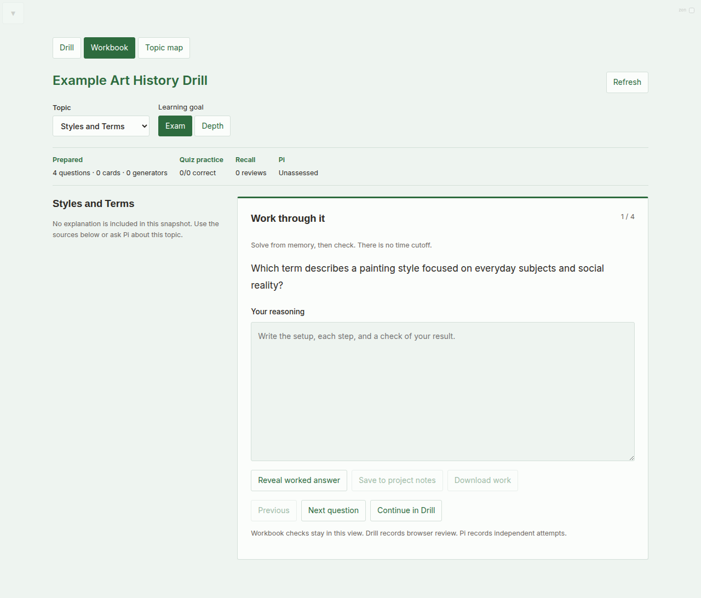
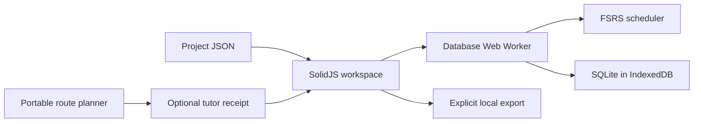

<p align="center"></p>
<h1 align="center">Study Tool</h1>
<p align="center">Focused practice. Clear feedback. Reviews when they are due.</p>

Study Tool is a local-first browser workspace for flashcards, quizzes, math practice, and source-linked learning. Use Drill for scheduled recall, Workbook for worked reasoning, and Topic map to explore prerequisites. Review state stays in your browser. With the local server, autosave also writes project backups to disk. Optional AI and media features can send external requests.



## Start studying

Use Node.js 24 or newer.

```bash
npm ci
npm run dev
```

Open **http://localhost:3000** and select the included synthetic example. You can also import a project JSON file. If the server already runs on port 3000, reuse it.

| Start here | What you will find |
| --- | --- |
| [Study modes](docs/modes.md) | Each view, review option, and learning mode |
| [Components](docs/architecture.md) | Code ownership, data flow, storage, and local services |
| [Tutor integration](docs/integration.md) | Portable route planner and workspace receipt contract |
| [Project format](projects/README.md) | Importable sections, questions, and flashcards |
| [Privacy](docs/privacy.md) | Local data, optional network features, and publication boundaries |
| [Dependency notices](THIRD_PARTY_NOTICES.md) | Dependencies and design sources |

## Choose your work

| View | Purpose | What it records |
| --- | --- | --- |
| **Drill** | Recall a card or answer a quiz question, then review it again when due. | Browser review events and card scheduling state. |
| **Workbook** | Write an answer and reasoning, inspect a hint, or check a generated math answer. | Drafts in the current view; explicit saves go to browser project notes, and downloads create a file. |
| **Topic map** | Follow prerequisites, source references, and supplied evidence for a topic. | Displays existing evidence; opening a topic does not award mastery. |

Drill includes flashcards, multiple-choice questions, passage questions, and generated math exercises. Exam and depth modes guide the learning workspace. Simple mode, cram, merged sections, mixed card sides, and zen mode change the review experience. [Read how the modes differ](docs/modes.md).

## Check the package

```bash
npm test -- --maxWorkers=2
npm run test:harness
npm run build
```

The build produces `dist/`. Static hosting supports imported projects and browser review. Local file access, AI bridging, workspace receipts, and disk exports require the development server or a separately implemented backend. The install manifest is included, but the current service worker removes old caches; this release does not promise offline page loading.

## How it works



The UI sends typed requests to a Web Worker so database work stays off the main thread. SQLite stores review state in IndexedDB, and `ts-fsrs` calculates the next due date. The portable planner selects learning work from supplied topics and attempts. It keeps recall, coached work, and independent practice distinct.

This repository includes application code, tests, a portable planner, and synthetic examples. Personal decks, course files, learner histories, credentials, machine settings, and the private tutoring installation are excluded. No license is granted for the project's own code unless a license file is added; dependencies retain their respective licenses.
